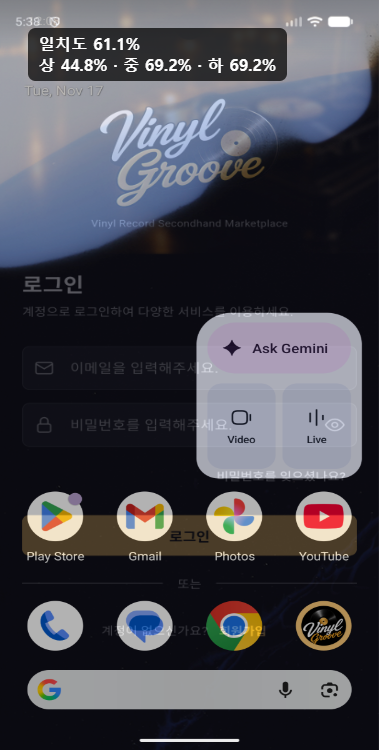

# wordskills-diff-screen

안드로이드 에뮬레이터 화면 위에 프로토타입 사진(PNG)을 겹쳐 놓고, 눈과 숫자(일치도 %)로 차이를 확인하는 Windows용 Electron 도구입니다.



## 주요 기능
- 보기 모드: 사진 / 겹침 / 분할(슬라이더) / 차이(붉게 표시) / 앱 — **F4**로 어느 창에서든 앱과 직전 모드를 전환
- 일치도: 전체 + 상·중·하 구역 점수, 상태바·하단바 제외
- 사진 폴더 기억, ←/→로 사진 넘기기, **자동 매칭**, 화면↔사진 연결
- 도구: 측정(px/dp), 가이드선, 눈금자(dp), 색상 스포이드
- 다른 창이 위에 오면 오버레이가 물러나고, 멀티 모니터를 지원
- 자동 업데이트(설치본)

**자세한 사용법과 화면은 [docs/USAGE.md](docs/USAGE.md)를 보세요.**

## 개발
```
npm install
npm start
```
| 명령 | 내용 |
|---|---|
| `npm run selftest` | adb·에뮬레이터 없이 하는 자체 점검 (실제 창을 띄우므로 실행 중에는 다른 창으로 가리지 마세요) |
| `npm run e2e` | 실제 키 입력(F4, ←/→)으로 하는 점검 |
| `npm run emutest` | 켜진 에뮬레이터(adb 필요)로 하는 점검 |
| `npm run build` | `dist/`에 NSIS 설치 파일 생성 |

설정은 `%APPDATA%/wordskills-diff-screen/config.json`에 저장됩니다. 코드 서명이 없어 처음 실행 시 SmartScreen 경고가 뜰 수 있습니다.

## 릴리스와 자동 업데이트
1. `package.json`의 version을 올리고 `npm run build`
2. 커밋 후 `git tag v<버전>`, `git push origin main v<버전>`
3. GitHub에서 `v<버전>` 태그로 **공개(draft 아님) 릴리스**를 만들고 `dist/`의 파일 3개를 첨부
   - `wordskills-diff-screen-setup-<버전>.exe` — 설치 프로그램
   - `wordskills-diff-screen-setup-<버전>.exe.blockmap` — 바뀐 부분만 받게 해 주는 조각 목록
   - `latest.yml` — 최신 버전 정보(앱이 가장 먼저 읽음)
4. 설치된 앱이 새 버전을 받아 [재시작하여 설치]로 갱신합니다.

v0.2.x 설치본에는 업데이트 기능이 없어 v0.3.0 이상을 한 번 직접 설치해야 합니다.
