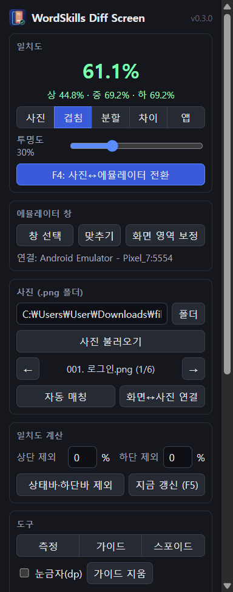
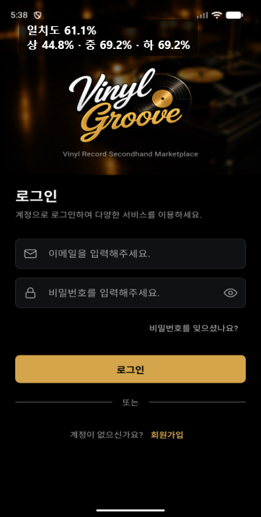
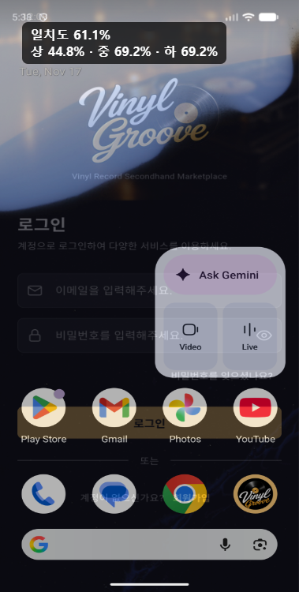
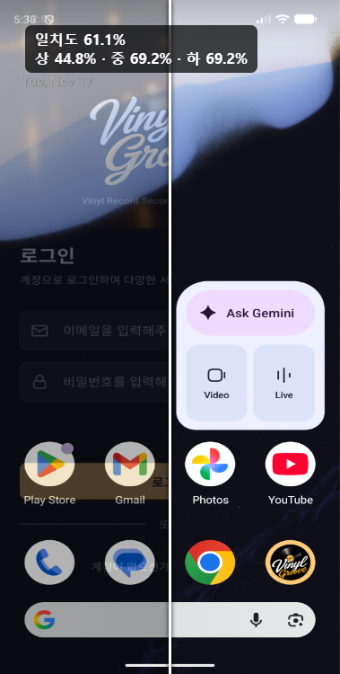
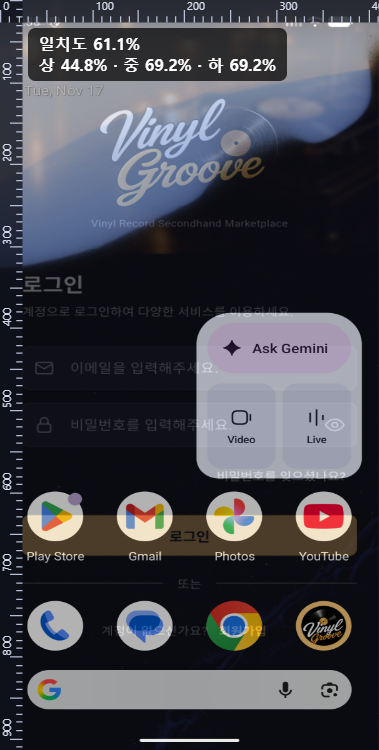
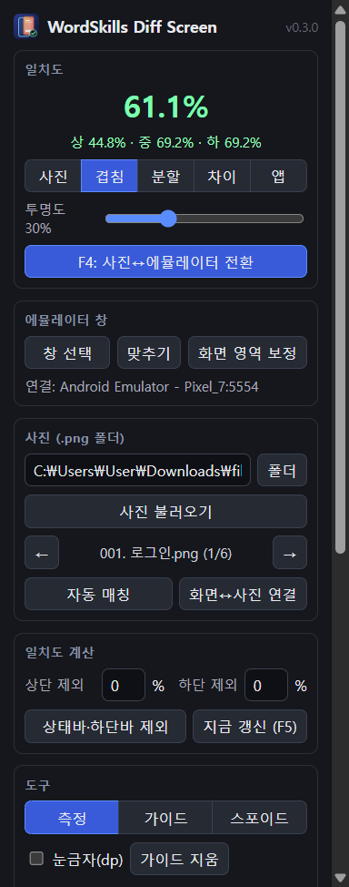

# 사용법

에뮬레이터 화면 위에 프로토타입 사진(PNG)을 겹쳐 놓고 디자인과 구현의 차이를 눈으로, 그리고 숫자(일치도 %)로 확인하는 도구입니다.

## 1. 시작하기
1. 설치 파일(`wordskills-diff-screen-setup-<버전>.exe`)을 실행해 설치합니다. (코드 서명이 없어 SmartScreen 경고가 뜨면 *추가 정보 → 실행*)
2. Android 에뮬레이터를 켭니다. AVD 설정의 *Enable Device Frame*은 꺼 두세요.
3. 앱을 켜고 **창 선택**에서 `Android Emulator - …` 창을 고릅니다. 사이드바가 에뮬레이터 옆에 붙습니다.
4. **폴더**(또는 경로 입력 후 Enter)로 프로토타입 `.png`가 든 폴더를 지정합니다. 경로는 기억됩니다.

> 일치도 계산은 `adb`로 에뮬레이터 화면을 받아 오므로 Android SDK의 `platform-tools`가 필요합니다. 자동으로 못 찾으면 **adb 지정**으로 `adb.exe`를 알려 주세요.

## 2. 보기 모드
위쪽 버튼 5개로 사진을 어떻게 보여줄지 고릅니다.

| 모드 | 동작 |
|---|---|
| 사진 | 사진만 100%로 보여 줍니다 |
| 겹침 | 투명도 슬라이더만큼 반투명하게 겹칩니다 (기본) |
| 분할 | 좌우로 나눠 한쪽은 사진, 한쪽은 앱. 분할 슬라이더로 경계 이동 |
| 차이 | 사진과 다른 픽셀을 붉게 표시. 민감도 슬라이더로 기준 조절 |
| 앱 | 오버레이를 숨기고 에뮬레이터만 표시 |

**F4**는 어느 창에서든 *지금 모드 ↔ 앱*을 오가고, 돌아올 때는 직전 모드로 갑니다. (창과 사진을 모두 고른 뒤에 동작)

## 3. 사진 넘기기와 자동 매칭
- **← / →**: 폴더 안의 이전/다음 사진 (사진이 보이는 상태에서, 앱 또는 사이드바 창이 앞일 때)
- **자동 매칭**(버튼으로 켬): 에뮬레이터 화면과 가장 비슷한 사진으로 알아서 바꿉니다. 깜빡임을 막기 위해 2번 연속 확인되고 현재 사진보다 확실히 더 비슷할 때만 바뀝니다. 앱 화면(F4)을 보는 중에는 사진만 바뀌고 오버레이는 다시 뜨지 않습니다.
- **화면↔사진 연결**: 사진과 앱 모습이 많이 다른 화면에서 한 번 눌러 두면 그 화면을 기억해 다음부터 자동 매칭이 같은 사진을 고릅니다. (사진당 최대 6개)

## 4. 일치도
- 큰 숫자는 에뮬레이터 화면과 사진의 전체 일치도, 아래는 상·중·하 3구역 점수입니다. 1.5초마다(또는 **F5**) 갱신됩니다.
- **상단/하단 제외 %**: 상태바·제스처 바처럼 비교가 의미 없는 구역을 뺍니다. **상태바·하단바 제외**는 3%/3% 프리셋입니다.

## 5. 도구
| 도구 | 사용법 |
|---|---|
| 측정 | 사진 위를 드래그하면 크기를 px와 dp로 표시 (기기 해상도·밀도는 adb에서 읽음) |
| 가이드 | 위/왼쪽 눈금자를 클릭하면 선이 생기고, 우클릭하면 지워짐 |
| 스포이드 | 클릭한 곳의 사진 색(`#RRGGBB`, Flutter `Color(0xFF…)`)을 표시하고 사진 색을 클립보드에 복사, 앱 화면 색도 함께 표시 |
| 눈금자(dp) | 체크하면 가장자리에 dp 눈금자 표시 |

도구를 켜면 오버레이가 마우스를 받으므로 에뮬레이터를 직접 조작하려면 도구를 끄세요.

## 6. 위치 맞추기
- 창을 옮기거나 크기를 바꾸면 오버레이가 따라갑니다 (**자동 맞춤**). 기본값은 에뮬레이터 아래쪽 기준에 사진 비율로 맞춥니다.
- 어긋나면 **화면 영역 보정**에서 에뮬레이터 화면의 왼쪽 위 → 오른쪽 아래를 차례로 클릭합니다.
- **Ctrl+Alt+방향키**(Shift는 10px)로 미세 이동, **Ctrl+Alt+0**으로 초기화합니다.
- 다른 창(코드 에디터 등)이 에뮬레이터 위에 겹치면 오버레이가 자동으로 물러납니다. 모니터가 여러 대여도 동작합니다.

## 7. 단축키
| 키 | 동작 | 범위 |
|---|---|---|
| F4 | 현재 모드 ↔ 앱 | 어느 창에서든 |
| F5 | 일치도 갱신 | 앱/사이드바 창이 앞일 때 |
| F6 | 클릭 통과 켜기/끄기 | 〃 |
| ← / → | 이전/다음 사진 | 〃 |
| Ctrl+Alt+방향키, 0 | 미세 이동, 초기화 | 〃 |
| Ctrl+Alt+PageUp/Down | 투명도 ±5% | 〃 |

## 8. 업데이트
설치본은 시작할 때 GitHub 릴리스에서 새 버전을 확인합니다. 새 버전이 있으면 자동으로 받고, **재시작하여 설치**를 누르면 적용됩니다(앱을 종료할 때도 자동 설치). 사이드바 아래쪽 **업데이트 확인**으로 직접 확인할 수도 있습니다.

## 문제 해결
- **창 목록이 비어 있음**: 앱을 다시 켜고 **창 선택**을 누르세요.
- **일치도가 `--`**: adb가 연결됐는지(`adb devices`), **adb 지정**을 확인하세요.
- **오버레이가 안 보임**: 다른 창이 에뮬레이터를 가리거나, 모드가 *앱*일 수 있습니다. F4 또는 모드 버튼을 확인하세요. 에뮬레이터의 "Compatibility Warnings" 대화상자가 화면을 가려도 물러나니 닫아 주세요.
